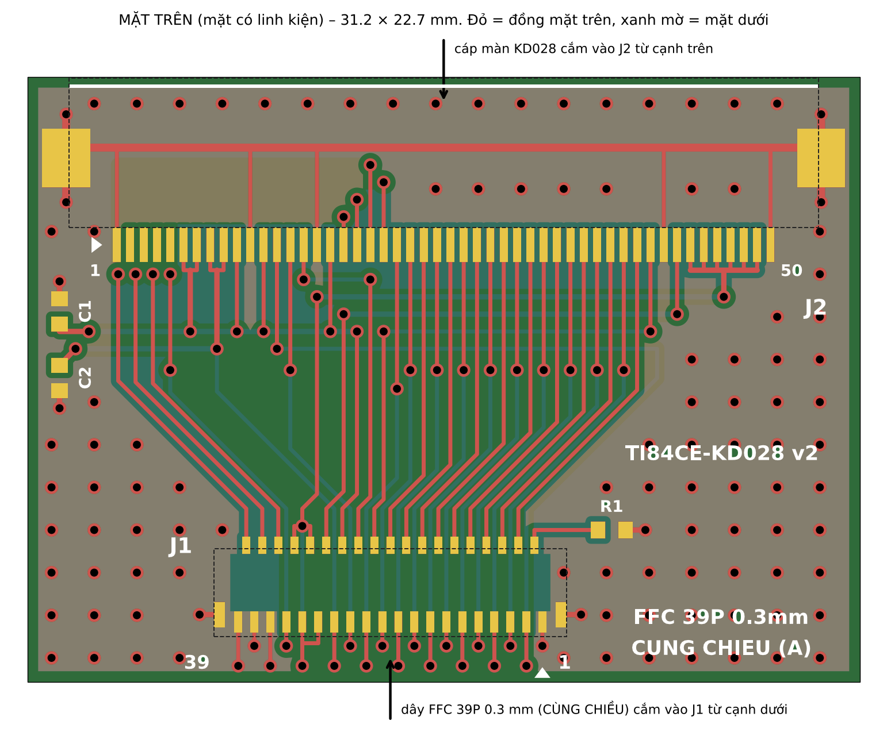
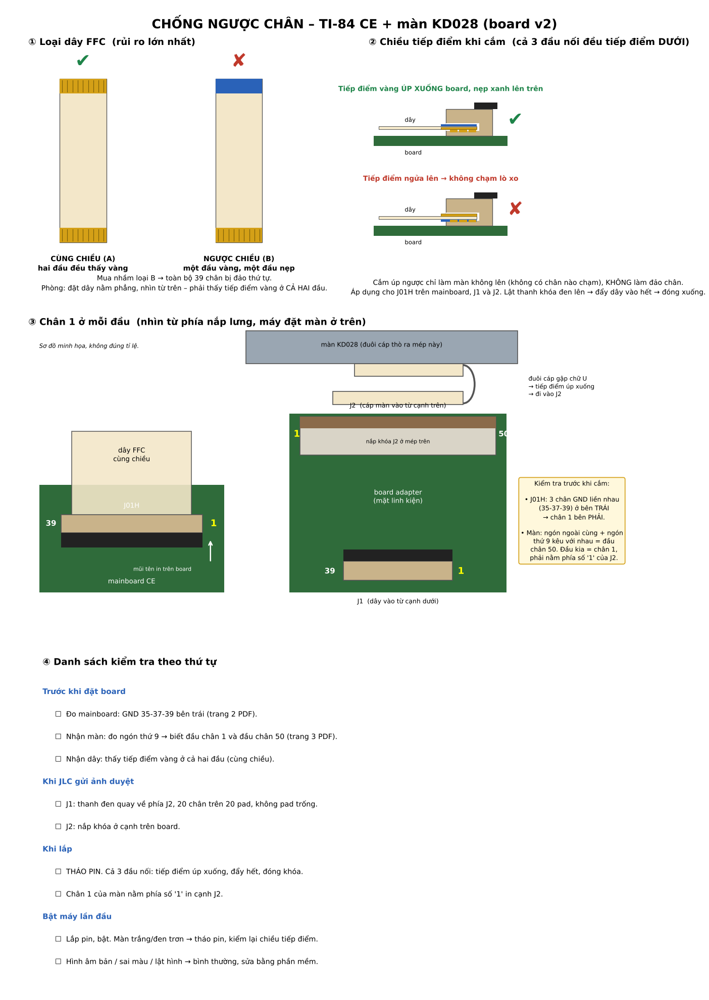
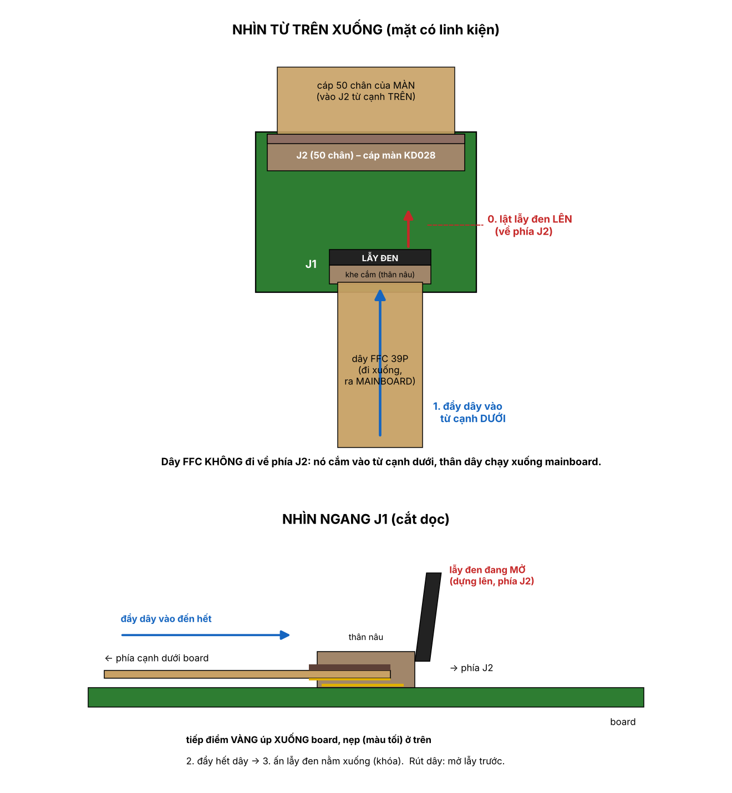

# TI-84 Plus CE → KD028QVFMA027 display adapter

Replace a broken **TI-84 Plus CE** screen with a cheap, easy-to-buy **2.8" 240×320 IPS panel (Kedake/Startek KD028QVFMA027, ST7789V, 50-pin 0.5 mm FPC)** instead of the hard-to-find original (GPM1421C0 / GPM1607A1).

Contents:
- a small 2-layer adapter board, JLCPCB-assembled, so no soldering is needed;
- a 39-pin 0.3 mm FFC cable from the calculator's display connector to the board;
- **AKDFIX**, a tiny calculator program that sends the panel's own voltage, gamma and inversion settings.

> **Status: boards ordered, not yet tested on hardware.** Everything here has been checked on paper and in software (independent Gerber re-reading, orientation proofs, a CPU simulator for the program), but no unit has been powered up yet. Results will be posted here. Use at your own risk.

<p align="center"></p>

## How it works

The CE drives its display over **3-wire SPI (9-bit)** for commands and **18-bit parallel RGB** (DB0–17, VSYNC, HSYNC, DCLK, ENABLE) for pixels. The KD028 panel's controller is from the same Sitronix ST7789 family and exposes the same interfaces, so the board only re-routes signals:

- **Interface select.** The panel's IM2/IM1/IM0 = 1/0/1 is tied on the board, and RD/WR are strapped to fixed levels (3-wire SPI + RGB).
- **TE.** The CE's TE pin is not used by the OS (WikiTI lists it as unconnected). It is pulled to GND through R1 (100 kΩ).
- **Backlight.** The four LED cathodes from the CE are merged onto the panel's LEDK pins.
- **Decoupling.** C1 and C2 (100 nF) decouple IOVCC and VCC.
- **Unused pins.** Panel pins 2–5 are left open.

The OS never reads an ID back from the panel (read commands are unreliable on the CE), so nothing blocks a different panel. Every command the OS and the CE toolchain's `lcddrvce` send exists in the ST7789V command set. The panel is IPS, so the image may appear inverted until INVON is sent; **AKDFIX** does that.

## Repository layout

| Path | What |
| --- | --- |
| `hardware/rigid-v2/` | **The board that was ordered.** 31.2 × 22.7 mm, 0.8 mm FR-4, 2 layers |
| `hardware/rigid-v2/fab/` | JLCPCB upload: Gerber zip, BOM, CPL |
| `hardware/rigid-v2/print/` | 1:1 printable PDF (fit check + mainboard/panel orientation checks), orientation sheet |
| `hardware/rigid-v2/src/` | Python generator (`out_r.py`), independent verifier (`verify_r.py`), renderers |
| `hardware/flex-v3-experimental/` | One-piece flex alternative (no FFC). **Never fabricated** (too expensive with stiffeners) |
| `software/akdfix/` | AKDFIX source (eZ80 asm), prebuilt `AKDFIX.8xp`, simulator test |
| `docs/images/` | Insertion and orientation diagrams |

## Bill of materials

| Ref | Part | LCSC |
| --- | --- | --- |
| J1 | Hirose FH26W-39S-0.3SHW(60), 39P 0.3 mm, bottom contact (same family as the CE's own connector) | C92280 |
| J2 | Hirose FH12-50S-0.5SH(55), 50P 0.5 mm, bottom contact | C202116 |
| R1 | 100 kΩ 0402 | C25741 |
| C1, C2 | 100 nF 16 V X7R 0402 | C1525 |
| — | FFC 39P 0.3 mm pitch, **same-side contacts (type A)**, 0.2 mm contact thickness | — |
| — | KD028QVFMA027 panel (non-touch) | — |

JLCPCB settings used: 2 layers, 0.8 mm, green mask, Economic PCBA top side, 2 assembled. JLC's estimate was about 22 USD plus shipping.

## Pin mapping (re-read from the Gerbers by `verify_r.py`)

| CE connector | → | KD028QVFMA027 |
| --- | --- | --- |
| 1, 35, 37, 39 GND | → | 1, 42, 50 GND; 11 IM1 (=0); 16 WR (=0) |
| 2 TE | → | not connected, 100 kΩ to GND |
| 3 RESET | → | 13 RESET |
| 4…21 DB17…DB0 | → | 40…23 DB17…DB0 |
| 22 SDO / 23 SDI | → | 41 SDO / 22 SDA |
| 24 WR/SCL / 25 CS | → | 15 RS (SPI SCL) / 14 CS |
| 26 IOVCC | → | 6, 7 IOVCC; 10 IM2 (=1); 12 IM0 (=1); 17 RD (=1) |
| 27 VCC | → | 8, 9 VCI |
| 28 LED_A / 29…32 LED_K | → | 43 LEDA / 44…49 LEDK |
| 33 VSYNC, 34 HSYNC, 36 DCLK, 38 ENABLE | → | 18, 19, 21, 20 |
| — | | 2–5 open |

## Orientation: the part that is easy to get wrong

A flat cable can arrive mirrored. For every cable end, the scripts track the sign of det[tip direction, contact normal, pin-1 side], which folding a cable does not change. For this design:

- **CE end: +1. KD028 FPC end: −1.**
- **Same-side (type A) FFC is required** with this board.
- If your mainboard test comes out reversed, a reversed (type B) FFC is the fix.

<p align="center"> </p>

Before powering on:
1. **Mainboard GND test** (PDF page 2). Look at the back of the board with the screen side up and the connector at top-left. The three GND pins 35, 37, 39 must be on the **left**.
2. **Continuity between mainboard pins 29–32** (LED cathodes). The adapter merges them, so check how they behave on your board first.
3. Inspect J1's solder joints under magnification. Check C1 and C2 for shorts.
4. **KD028 tail into J2**: contacts face down onto the board, and the "1" mark goes on the **left**.
5. **FFC**: contacts face down at both ends (both connectors are bottom-contact).
6. **Remove the battery** whenever you plug or unplug anything.

## AKDFIX

`software/akdfix/AKDFIX.8xp` is an assembly program for TI-84 Plus CE OS 5.x, 974 bytes. It runs directly on OS 5.4 and earlier; OS 5.5 and later need arTIfiCE.

At startup it sends SLPOUT, waits 120 ms, sends DISPON, then the panel vendor's values (B7, BB, C2, C3, C4, D0, positive/negative gamma) followed by INVON. This restores the display even if nothing is visible. It leaves the interface and orientation registers alone.

Menu (labels on screen are Vietnamese):

| Key | Action |
| --- | --- |
| 1 / 2 | INVON / INVOFF |
| 3 | Vendor values + INVON |
| 4 / 5 / 6 | Toggle MADCTL BGR / MX / MY |
| 7 | Back to TI defaults (INVOFF, MADCTL 08, TI gamma) |
| CLEAR | Exit |

Settings are lost at power-off. To build and test:

```sh
spasm -E -A AKDFIX.asm AKDFIX.8xp   # spasm-ng; output is byte-identical to the committed .8xp
python3 sim.py AKDFIX.8xp           # mini eZ80 interpreter: prints every SPI frame sent
```

The SPI routine mirrors `lcddrvce` from the CE C toolchain, including the Python-edition path. It restores TI-OS SPI settings on exit.

## Regenerating the hardware

Requires Python 3.11+ and `numpy shapely matplotlib gerbonara`.

```sh
cd hardware/rigid-v2/src
python3 out_r.py out/gerber        # Gerbers, drill, BOM, CPL
python3 verify_r.py out/gerber     # independent check -> "pin map check: PASS"
python3 render_r.py out            # previews + 1:1 PDF
```

`out_r.py` reproduces the committed fab files byte-for-byte. `verify_r.py` does not import the generator. It parses the Gerbers and the CPL, places the official KiCad footprints at the CPL coordinates, traces copper connectivity, and derives pin order from cable geometry. The flex v3 verifier also takes a `neg` argument, which flips one orientation on purpose and must report FAIL.

## Not included

These are not included for copyright reasons:
- the panel datasheet and the vendor's init code (ask Kedake/Startek for the KD028QVFMA027 spec);
- the TI panel datasheet;
- TI ROM or OS files.

Sources used:
- [WikiTI](https://wikiti.brandonw.net/) for CE LCD and SPI ports;
- the [CE C toolchain](https://github.com/CE-Programming/toolchain) `lcddrvce` library;
- the Sitronix ST7789V datasheet;
- the Hirose FH12/FH26 catalogs;
- the [KiCad footprint library](https://gitlab.com/kicad/libraries/kicad-footprints).

## License

MIT (see `LICENSE`) for everything except the KiCad reference footprints under `*/src/ref/`, which are CC-BY-SA 4.0 with the KiCad library exception.

Not affiliated with Texas Instruments. "TI-84 Plus CE" is a trademark of Texas Instruments.

---

## Tiếng Việt (tóm tắt)

Bộ chuyển để thay màn hỏng của TI-84 Plus CE bằng màn IPS **KD028QVFMA027** (ST7789V, cáp 50 chân 0.5 mm). Màn này giá rẻ và dễ mua.

- **Phần cứng:** board cứng 2 lớp do JLC hàn sẵn J1/J2/R1/C1/C2, không cần tự hàn. Nối với mainboard bằng **cáp FFC 39P 0.3 mm loại cùng chiều (A)**.
- **Phần mềm:** chương trình AKDFIX bật đảo màu (INVON) và nạp thông số điện áp, gamma của hãng.
- **Trạng thái:** đã đặt board, **chưa thử trên máy thật**.

Trước khi cắm điện, làm đủ các bước kiểm tra trong `hardware/rigid-v2/README.vi.md` và trang 2–3 của file PDF.
